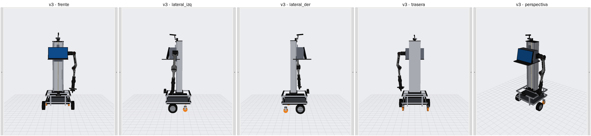
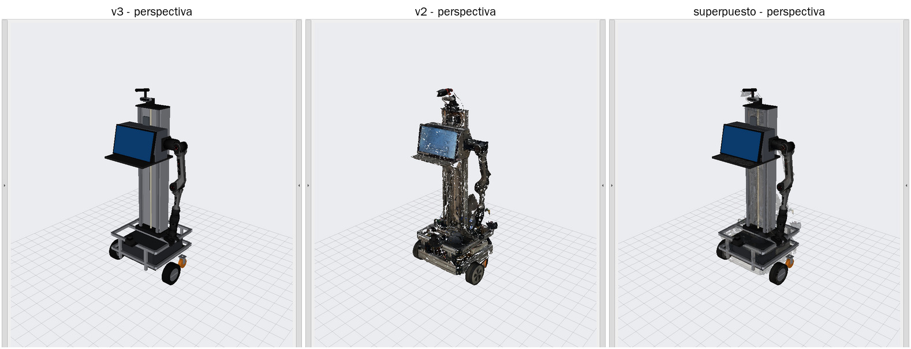
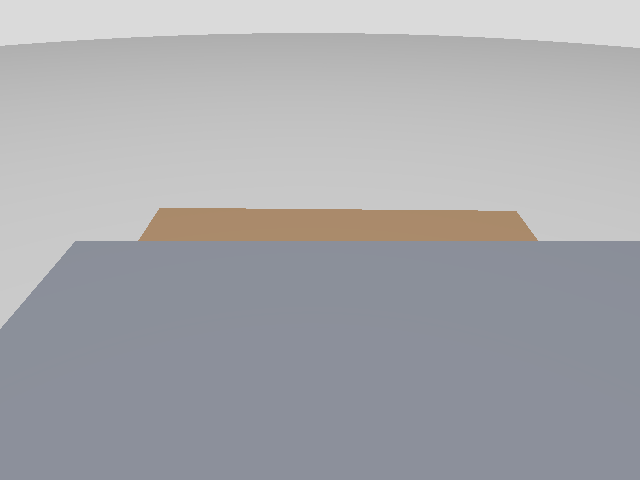
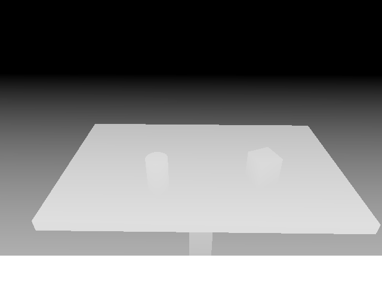

# Validación de robot_v3_description (Claude Cloud, 26/10/2026)

## Entorno usado

Claude Cloud (Ubuntu 24.04, sin ROS ni GPU) **no tiene acceso a la NUC, la Jetson ni el robot**. Para probar con
ROS 2 Humble real se usó un contenedor Docker efímero con paquetes de **RoboStack** (conda-forge, `ros-humble-*`):

| Componente | Versión |
|---|---|
| ROS 2 | Humble (rclpy, Python 3.11) |
| xacro / urdfdom (`check_urdf`) | 2.1.1 / 4.0 |
| ros2_control / ros2_controllers | 2.54 / 2.53 |
| ign_ros2_control | 0.7.19 |
| ros_gz / Ignition Gazebo | 0.244 / 6.16 (Fortress), render por software (Mesa llvmpipe + Xvfb) |

`packages.ros.org` está bloqueado por la política de red del entorno, por eso no se usaron los binarios `.deb`.
Las diferencias con la NUC (binarios apt) son de empaquetado; el código de ROS es el mismo. En la NUC hay que repetir
las pruebas con `tools/nuc_validate.sh` (§4).

## 1. Validación estática — 69/69

`tools/validate_v3.py` (detalle: [`evidencias/estatica_humble.md`](evidencias/estatica_humble.md)):

* xacro en las **24 combinaciones** de `ros2_control × head_mount × arm_limits × camera_frames`, y rechazo de argumentos inválidos.
* `check_urdf` (urdfdom) en 3 configuraciones: "Successfully Parsed" ([`evidencias/check_urdf.txt`](evidencias/check_urdf.txt)).
* Árbol: raíz única `base_footprint`, 38 links / 37 joints, sin ciclos; 36 frames de compatibilidad
  (base_athome, urg_node, Jetson, realsense) presentes; 13 articulaciones móviles.
* Límites: elevador = valores provisionales separados; Piper = perfiles `official` y `base_athome`; ejes unitarios.
* Cinemática: posiciones medidas reproducidas (error 0.000 mm); centro de la carcasa de la D435 = posición medida en v2 (0.05 mm).
* **Brazo vs. referencia independiente:** cadena `arm_base_link → link6` del URDF contra los parámetros MDH oficiales
  de `piper_sdk` en 202 poses: **máx. 0.088 mm** y ‖ΔR‖ 1.3e-7.
* Elevador (−0.19, +0.05, +0.068 m): caja, pantalla, brazo y TCP se trasladan exactamente en Z; columna, ruedas y láser
  quietos; cámara quieta (`head_mount:=column`) o arrastrada (`lift`).
* D435: 4 frames ópticos REP-103, extrínsecos nominales de Intel; `camera_frames:=false` elimina los 8 frames del driver.
* Recursos: 20 mallas referenciadas, todas dentro del paquete, sin archivos sin usar; 12.5 MB, sin texturas.
* Inercias definidas positivas; ros2_control (mock y Gazebo) declara las 13 articulaciones; sensores Gazebo presentes.
* `robot_v2_description` idéntico al commit `9401da9` (`git diff` y `git status` vacíos).

`colcon build` + `colcon test`: 2 tests, 0 errores, 0 fallas.

## 2. Ejecución con ros2_control mock — 26/26 (y 26/26 con `head_mount:=lift`)

`sim_mock.launch.py` + `tools/runtime_checks.py`, con `robot_state_publisher`, `controller_manager` y
`joint_trajectory_controller` reales:

* `/joint_states` con las 13 articulaciones; TF de los 38 links = cinemática del URDF (0.000 mm) en cada estado.
* Elevador a +0.05, −0.15 y 0 m por `lift_controller`: la caja se mueve exactamente en Z, la columna no.
* Brazo a `DEFAULT_HOME` (pose de la Jetson) por `arm_controller`: `tcp_link` en TF = cinemática directa.
* Pinza abierta (±0.035 m): dedos separados 70 mm. Cabezal: tilt +0.3 rad → eje óptico hacia adelante y abajo.
* `demo_motion.py`: las cuatro secuencias terminan con `SUCCESSFUL` ([`evidencias/demo_motion.txt`](evidencias/demo_motion.txt)).
* Guardia de dominio: con `ROS_DOMAIN_ID=10` el launch aborta con un mensaje explicativo ([`evidencias/domain_guard.log`](evidencias/domain_guard.log)).

Evidencias: [`runtime_mock.txt`](evidencias/runtime_mock.txt), [`runtime_mock_lift.txt`](evidencias/runtime_mock_lift.txt),
árbol TF de `view_frames`: [`arbol_tf.pdf`](evidencias/arbol_tf.pdf).

Capturas de RViz desde 5 vistas y comparación con v2: [`evidencias/visual/`](evidencias/visual/).

## 3. Estados "reales" — 9/9

`real_state.launch.py` + `tools/check_real_state.py`: se publican en `/joint_states` mensajes con el mismo formato que
`piper_arm_controller.py` (joint1–8) y que `pan_tilt_node` (pan/tilt), en un dominio de prueba. El combinador completa
elevador y ruedas en 0, y la TF de `tcp_link`, `link7`, `link8`, `camera_link` y `mounting_cube_link` coincide con la
cinemática calculada **a partir de los valores publicados** ([`evidencias/real_state.txt`](evidencias/real_state.txt)).

## 4. Ignition Gazebo Fortress — 32/32

`gazebo.launch.py headless:=true` + `runtime_checks.py --use-sim-time --tolerance 0.01 --sensors`
([`evidencias/runtime_gazebo.txt`](evidencias/runtime_gazebo.txt)):

* Los 6 controladores activos (incluida la base diferencial); mismos chequeos de TF, elevador, brazo, pinza y cabezal que en mock, con física.
* Sensores simulados con `frame_id` correctos: color, profundidad alineada y nube en `camera_color_optical_frame`; `/scan` en `laser` (1081 haces).

| Color (D435 simulada, tilt 0.55 rad) | Profundidad alineada |
|---|---|
|  |  |

La mitad inferior de la imagen es la caja del propio robot: con la geometría medida, por debajo de unos 26° de
inclinación la caja con el monitor tapa la vista de la cámara. Hay que verificarlo en el robot (ver README, §9).

## 5. Problemas encontrados y corregidos durante la validación

| Problema | Causa | Corrección |
|---|---|---|
| En Gazebo, el elevador caía al tope inferior y quedaba trabado | `ign_ros2_control` sigue la posición con un comando de velocidad; si supera el límite del URDF (0.05 m/s), DART lo descarta. Se reprodujo de forma aislada ([`gazebo_elevador_sobrevelocidad.txt`](evidencias/gazebo_elevador_sobrevelocidad.txt)) | Los scripts calculan las duraciones según los límites del URDF; documentado en README §6 |
| `real_state.launch.py` publicaba ceros | El remapeo `joint_states → /robot_v3/joint_states` también renombraba la fuente absoluta `/joint_states` | El combinador corre en el namespace `robot_v3`, sin remapeo |
| `source_list` como sustitución de launch se convertía en `'/'` | Una lista con una `LaunchConfiguration` se concatena | Lista literal |
| `nuc_validate.sh` fallaba al hacer `source install/setup.bash` | `set -u` con los scripts de colcon | Se quitó `set -u` |
| El chequeo de profundidad miraba el centro de la imagen (cielo vacío) | Chequeo mal planteado | Fracción de píxeles válidos y mediana plausible |
| Colores incorrectos en RViz (columna negra, ruedas sin llanta) con varias `<visual>` por link | RViz2 aplica a todas las `<visual>` de un link el material de la primera | Un DAE multicolor por link (`meshes/structure/`) |
| `display.launch.py` abortaba con xacro 2.1 | `range()` en expresiones xacro genera avisos por stderr y `launch` aborta ante cualquier salida por stderr de `Command` | Sin `range()`; el validador falla si xacro escribe algo en stderr |
| En Gazebo, `gripper_controller` no se activaba a veces | El primer cambio de estado expiraba (5 s) mientras Gazebo cargaba los sensores | `joint_state_broadcaster` primero, el resto después, con `--switch-timeout 60` |
| "No Image" en RViz | Nadie publica la imagen en `display.launch.py` (sin simulador ni driver) | Diagnóstico en [`no_image_diagnostico.txt`](evidencias/no_image_diagnostico.txt); panel quitado de la configuración por defecto |

## 6. Qué NO se probó aquí

* Nada sobre el hardware real (por diseño): ni CAN, ni el ESP32 del elevador, ni los Dynamixel, ni el driver de la D435.
* Binarios apt de Humble y GPU Intel de la NUC: repetir con `tools/nuc_validate.sh ~/robot_v3_ws --gazebo`.
* GUI de Gazebo y de `joint_state_publisher_gui` (solo RViz con Xvfb).

## 7. Pinza con un solo grado de libertad (27/10/2026)

`joint8` pasó a ser mimic de `joint7` (×−1, relación oficial de AgileX). Pruebas, comandando **solo** `joint7`:

| Entorno | Prueba | Resultado |
|---|---|---|
| Humble y Jazzy | `validate_v3.py`: mimic ×−1, límites espejo; cerrada, a mitad y abierta (0, 17.5 y 35 mm por dedo): dedos simétricos, separados 0, 35 y 70 mm | 69/69 |
| Jazzy | `joint_state_publisher_gui`: 12 sliders, `joint7` sí y `joint8` no | [captura](evidencias/pinza/jazzy_joint_state_publisher_gui.png) |
| Jazzy | `joint_state_publisher` con solo `joint7 = 0.02`: publica `joint8 = -0.02` | [jsp_mimic](evidencias/pinza/jazzy_jsp_mimic.txt) |
| Humble y Jazzy | mock: `gripper_controller` con `joints: [joint7]`; `joint8` = −17.5, −35 y 0 mm; separación 35, 70 y 0 mm | 26/26 ([Jazzy](evidencias/pinza/jazzy_runtime_mock.txt), [Humble](evidencias/runtime_mock.txt)) |
| Humble | Gazebo Fortress: dedo físico sincronizado (`joint8_mimic` = −`joint7`), separación 35, 70 y 0 mm | 32/32 ([runtime_gazebo](evidencias/runtime_gazebo.txt)) |
| Humble y Jazzy | `real_state.launch.py` con `/joint_states` tipo Jetson (`joint7` y `joint8`): el `joint8` combinado coincide con el de la Jetson | 9/9 |

La simulación de Gazebo en Jazzy (Harmonic, `gz_ros2_control`) no está implementada en este paquete; `gazebo.launch.py` es para Fortress/Humble.

