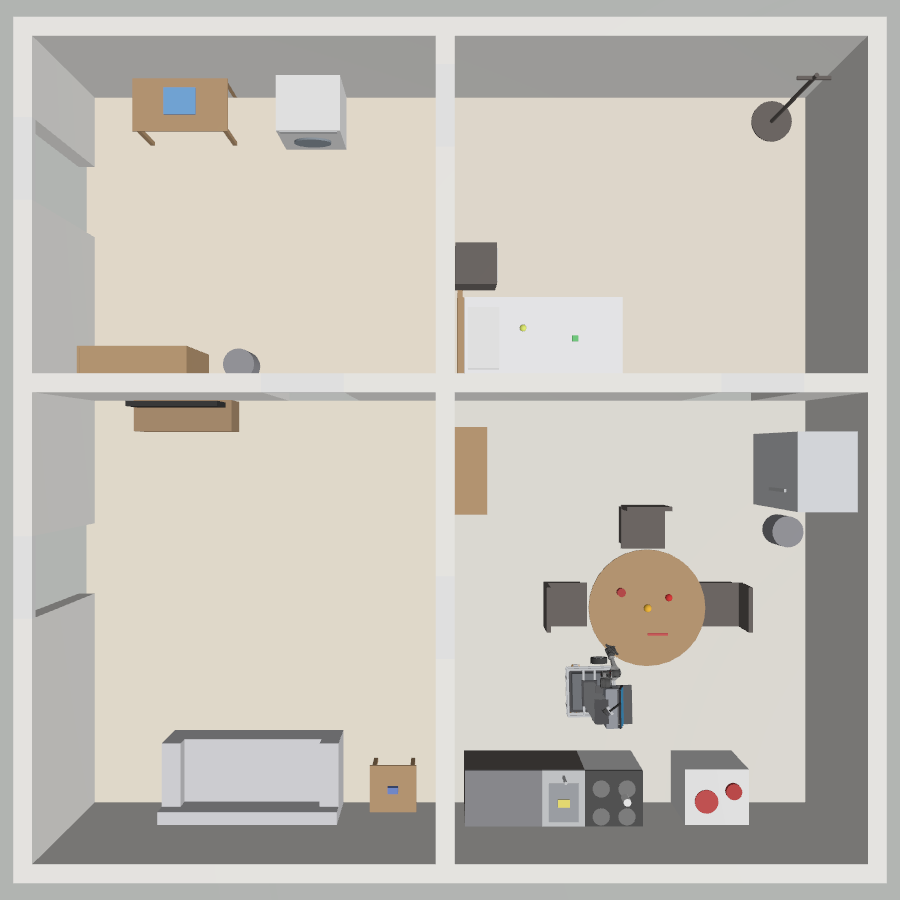

# Especificación de la arena doméstica

Fuente: `docs/referencias_desafios/` (12 imágenes inspeccionadas). Fuente de verdad de la geometría:
`config/arena_spec.yaml` → `tools/make_worlds.py` → `worlds/home_arena.sdf` (no editar el SDF a mano).

## Qué es dato y qué es supuesto

| Elemento | Origen |
|---|---|
| Puerta de referencia 2.00 × 0.70 m | **Oficial** (imagen 05, restricciones) |
| Distribución: lavandería (arriba-izq.), dormitorio (arriba-der.), sala (abajo-izq.), cocina (abajo-der.) | Planos 10–12 |
| Posición relativa y numeración de los 18 muebles; cuáles admiten objetos (*) | Plano 10 |
| Categorías de objetos por ubicación (snacks, vajilla, limpieza, frutas, bebidas, comida, telas, juguetes) | Plano 11 |
| Zonas de evaluación (P&P en la cocina, superficie extra junto a la mesada, inicio frente a la puerta de entrada) | Plano 12 |
| **Escala 0.02 m/px** | **Supuesto derivado**: los vanos de puerta del plano miden ~35 px y se asumen de 0.70 m. Casa: 7.40 × 7.34 m |
| Posiciones y tamaños en planta | Medidos en píxeles del plano 10 × escala (±1 vano ≈ ±0.1 m) |
| Altura de mesas 0.74 m | Medida en el escaneo v2 del laboratorio (mundo de prueba de robot_v3) |
| Resto de alturas (mesada 0.90, lavarropas/lavavajillas 0.85, heladera 1.80, estante 1.20, cama 0.50, sofá 0.85, paredes 2.10) | **Supuestos** típicos de mobiliario |
| Dimensiones y masas de los objetos (primitivas) | **Supuestos** típicos de los objetos de las imágenes 06–09 |
| Puertas | Vanos sin hoja (la apertura de puertas es tarea opcional de desafíos futuros) |

Frame del mundo: origen en la esquina exterior inferior-izquierda del plano, X hacia la derecha, Y hacia arriba.

## Mobiliario (id del plano 10)

Lavandería: 1 mesa de doblado (*), 2 lavarropas (*), 3 estante (*), 4 tacho. Dormitorio: 5 cama (*), 17 mesa de
luz (*), 18 perchero. Sala: 6 mueble de TV (*), 7 sofá (*), 8 mesa baja (*). Cocina: 9 armario (*), 10 heladera,
11 mesada (*), 12 pileta, 13 cocina/anafe (*), 14 lavavajillas (*), 15 tacho, 16 mesa del comedor (*) con 3 sillas
(el lado sur queda libre para el robot en la demo).

Objetos (16, primitivas con color): vajilla roja (plato, bowl, taza, tenedor), limpieza (esponja, Soft Scrub),
frutas (naranja, manzana), bebidas (lata de cola, botella de leche), snacks (Jell-O, Pringles), comida (Spam),
telas (remera), juguetes (cubo Rubik, pelota de tenis), ubicados según el plano 11.

## Mundo de entrenamiento `pick_place_training`

Liviano (sin casa) para RL: piso, mesa de 0.80 × 0.50 × 0.74 m a la izquierda del robot, cubo rojo de 4 cm
(60 g) y zona objetivo verde de 12 × 12 cm (solo visual). El robot aparece en el origen mirando a +X.
Dimensiones en `config/pick_place.yaml` (sección `world`).
